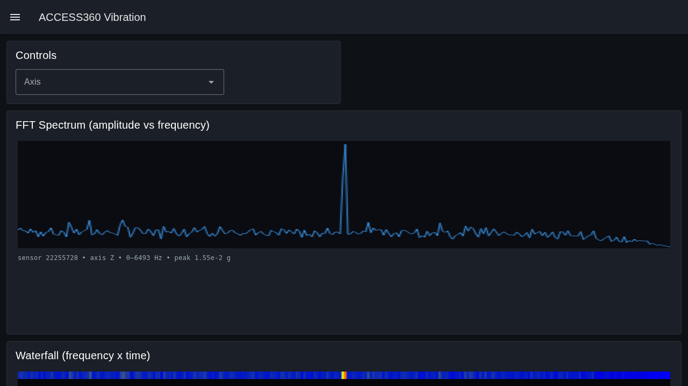
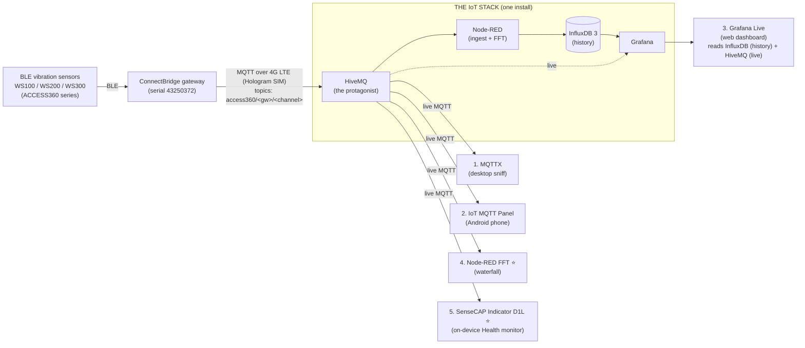

<p align="center">
  
</p>

<h1 align="center">5 Ways to Visualize Your CTC Connect ACCESS360 Series</h1>
<p align="center"><em>Five direct-to-HiveMQ ways to visualize a CTC Connect ACCESS360 wireless vibration monitoring fleet,<br>all served by one easy-to-install IoT stack.</em></p>

<p align="center">
  <a href="#the-5-methods"></a>
  <a href="#overview"></a>
  <a href="methods/03-grafana-live/"></a>
  <a href="methods/04-node-red-fft-waterfall/"></a>
  <a href="methods/05-sensecap-indicator-d1l/"></a>
</p>
<p align="center">
  
  
  
  
  
  
  
  <a href="LICENSE"></a>
  
</p>

## Overview

Five ways to **see** the live telemetry from a
[CTC Connect ACCESS360](https://www.ctconline.com/) wireless vibration
condition-monitoring fleet — from a quick desktop topic sniff to a hardware
"Fleet Health" panel that sits on your desk — all served by **one
easy-to-install IoT stack**.

**The broker is the protagonist.** An ACCESS360 ConnectBridge gateway speaks MQTT
natively, so [**HiveMQ**](https://www.hivemq.com/products/mqtt-broker-hivemq-community-edition/)
sits at the center of the stack and every method connects to it. Around the broker
the stack adds just enough — **Node-RED** (ingestion + flows), **InfluxDB 3**
(durable history), and **Grafana** (dashboards) — so you can both watch the fleet
**live** and keep **history**, which is what makes trends and "time since last
seen" actually work. Install the one stack and every method below has what it
needs; the lightweight methods can still talk straight to the broker if that is
all you want.

> **Status:** Phase 2 — methods 3 and 4 are **delivered and running live** on the IoT
> stack; methods 1 and 2 ship importable profiles/configs + real sample payloads;
> method 5's firmware is built and awaits a hardware flash. The repo is
> **self-contained**: all the backend context (broker, topics, payload schemas,
> sensor IDs, and the Fleet Health metric set) lives under [`docs/`](docs/), so the
> stack and every method build with no private repository needed.
>
> | # | Method | Status |
> |---|---|---|
> | 1 | MQTTX | ✅ profile + sample payloads |
> | 2 | IoT MQTT Panel | ✅ importable config (verify in app) |
> | 3 | Grafana Live | ✅ **delivered + live** |
> | 4 | Node-RED FFT/waterfall ⭐ | ✅ **delivered + live** |
> | 5 | SenseCAP Indicator D1L ⭐ | 🔧 firmware built (pending HW flash) |

---

## The system in one diagram



Methods 1, 2, 4 and 5 connect **straight to HiveMQ** (the broker-native value
prop). Method 3 (Grafana) leans on the rest of the stack — **InfluxDB 3 for
history** (fed by Node-RED) plus live MQTT — because a board with no store can't
show trends or "time since last seen." They differ in **where they run** and
**what they draw**.

---

## The 5 methods

| # | Method | Platform | What it shows | Tier |
|---|---|---|---|---|
| 1 | [**MQTTX**](methods/01-mqttx/) | Desktop (Win/macOS/Linux) | Live topic tree + raw JSON payload capture. The "is data actually flowing?" tool. | Quick look |
| 2 | [**IoT MQTT Panel**](methods/02-iot-mqtt-panel/) | Android phone | A pocket dashboard: gauges/values bound to topics. Glance at the fleet from your phone. | Quick look |
| 3 | [**Grafana Live**](methods/03-grafana-live/) | Web (browser) | Real-time streaming panels fed straight from HiveMQ via the MQTT data source. | Dashboard |
| 4 | [**Node-RED — FFT / Waterfall**](methods/04-node-red-fft-waterfall/) ⭐ | Web (browser) | The hero. Reassembles the raw waveform, computes the FFT, and renders a scrolling **spectrogram / waterfall** from the vibration topics. | Hero |
| 5 | [**SenseCAP Indicator D1L**](methods/05-sensecap-indicator-d1l/) ⭐ | ESP32-S3 hardware | The hero. A multi-screen on-device **"Health" monitor** mirroring Spectra Fleet Health (broker status, sensors online, battery %, RSSI, last-seen age, 4G usage). Status only — no raw plots. | Hero |

Each folder has its own README with **purpose, prerequisites, and setup steps**.

---

## Two flavors of visualization

The five methods split cleanly into two intents:

- **Signal visualization** (what is the machine doing?) — Method 4 (Node-RED FFT /
  waterfall) is the one that draws the actual vibration spectrum. It consumes the
  raw time-domain waveform arrays on `dyn/vib/notify` and turns them into a
  frequency-domain waterfall.
- **Fleet-health visualization** (is the system healthy?) — Methods 1, 2, 3, and 5
  surface operational health: broker up/down, sensors online, battery, RSSI,
  last-seen age, message rate, and 4G data usage. Method 5 (SenseCAP Indicator)
  is a dedicated, always-on hardware version of this view.

See [`docs/fleet-health-metrics.md`](docs/fleet-health-metrics.md) for the exact
metric definitions and thresholds the health views reproduce.

---

## Backend context (read this before building any method)

All five methods need the same four facts: where the broker is, what topics exist,
what the payloads look like, and which sensors/gateways are live. That context is
documented once, here:

| Doc | Contents |
|---|---|
| [`docs/iot-stack.md`](docs/iot-stack.md) | The stack reference: services, ports, volumes, `.env`, data flow, Node-RED flows, deploy, and the `spectra-io` boundary. |
| [`docs/backend-context.md`](docs/backend-context.md) | Broker connection (host, port, TLS, auth), network topology, deployment notes, the `192.168.68.150` Docker host. |
| [`docs/mqtt-topics.md`](docs/mqtt-topics.md) | Every MQTT topic with its exact JSON payload schema, types, units, and example messages. |
| [`docs/sensors-and-gateways.md`](docs/sensors-and-gateways.md) | Gateway serials and sensor IDs currently in use, model conventions (WS100/200/300). |
| [`docs/fleet-health-metrics.md`](docs/fleet-health-metrics.md) | The Spectra Fleet Health metric set: definitions, queries, thresholds, and 4G cost model. |
| [`docs/influx-mapping.md`](docs/influx-mapping.md) | How the stack's Node-RED ingestion maps MQTT payloads to InfluxDB 3 measurements — the schema behind the history/trends. |

---

## Getting started

### Quick start

1. **Install the stack.** Deploy the one IoT stack (HiveMQ + Node-RED + InfluxDB 3
   + Grafana) — as a Portainer stack or with `docker compose up -d`. See
   [**The stack**](#the-stack) below.
2. **Point the gateway at HiveMQ** (broker host + `access360/<gw>/<channel>`
   topics) and confirm data is flowing before building anything fancy:
   ```bash
   mosquitto_sub -h <stack-host> -t 'access360/#' -v
   ```
3. **Pick a method folder** and follow its README. Methods 1, 2, 4 and 5 only need
   the broker; method 3 (Grafana) uses InfluxDB history too — both come from the
   same stack.

> Stay on the **private plane** — the broker is meant for the LAN / homelab VPN and
> is **not** exposed to the internet.

---

## Repository layout

<details>
<summary><b>Tree</b></summary>

```
.
├── README.md                       ← you are here
├── LICENSE                         ← MIT
├── docs/                           ← self-contained backend context
│   ├── backend-context.md
│   ├── mqtt-topics.md
│   ├── sensors-and-gateways.md
│   ├── fleet-health-metrics.md
│   └── influx-mapping.md
└── methods/
    ├── 01-mqttx/
    ├── 02-iot-mqtt-panel/
    ├── 03-grafana-live/
    ├── 04-node-red-fft-waterfall/   ⭐
    └── 05-sensecap-indicator-d1l/   ⭐
```

</details>

## The stack

The whole backend is **one stack** you install once. Everything a reader needs is
the stack — nothing else, no private platform service in the path:

| Service | Role in the stack |
|---|---|
| **HiveMQ CE** (`iot-hivemq`) | MQTT 5.0 broker — the heart. The gateway and every method connect here. |
| **Node-RED** (`iot-nodered`) | The glue: flows ingest MQTT → InfluxDB 3, run the Method 4 FFT/waterfall, poll Hologram (4G), and expose a Prometheus `/metrics` exporter. No custom private microservice. |
| **InfluxDB 3 Core** (`iot-influxdb3`) | Durable history store (SQL via Flight SQL, database `ctc43250372`) — what makes trends and "last seen" work. |
| **Prometheus** (`iot-prometheus`, `:9091`) | The stack's own Prometheus; scrapes the Node-RED `/metrics` exporter for Method 3's System Health KPIs. |
| **Grafana** (`iot-grafana`) | Dashboards (Method 3), reading InfluxDB history + iot-prometheus KPIs + live MQTT. |

Install the whole stack from the top-level [`docker-compose.yml`](docker-compose.yml)
(`cp .env.example .env` first, then `docker compose up -d`, or import it as a Portainer
stack). Per-method helpers (the Method 4 flow, the ingestion + `/metrics` flow, the
Hologram flow) then install *into* this stack's `iot-nodered`.

> **Not part of this stack:** the **`spectra-ingester`** (and its own
> `spectra-prometheus`) belong to a **separate project, `spectra-io`**, and must not
> be touched. The 5-ways methods do **not** use that ingester — sensor data is
> ingested by a **Node-RED flow** in `iot-nodered` (writing to the `ctc43250372`
> InfluxDB database), which is what Method 3 reads.

> **Status:** the single top-level [`docker-compose.yml`](docker-compose.yml) bundles
> all six services (HiveMQ, Node-RED, InfluxDB 3 + UI, Grafana, Prometheus) on one
> network — deployable fresh anywhere. The author's homelab runs the same stack as one
> Portainer stack (`iot`); the repo template uses named volumes, the homelab uses host
> bind-mounts under `/opt/iot-stack/data` — equivalent.

## License

[MIT](LICENSE) © 2026 Jose Cedeno

---

<p align="center">
  Built by <b>Jose Cedeno</b> ·
  <a href="https://geekendzone.com">geekendzone.com</a> ·
  <a href="https://www.linkedin.com/in/joseangelcedeno/">LinkedIn</a>
</p>
